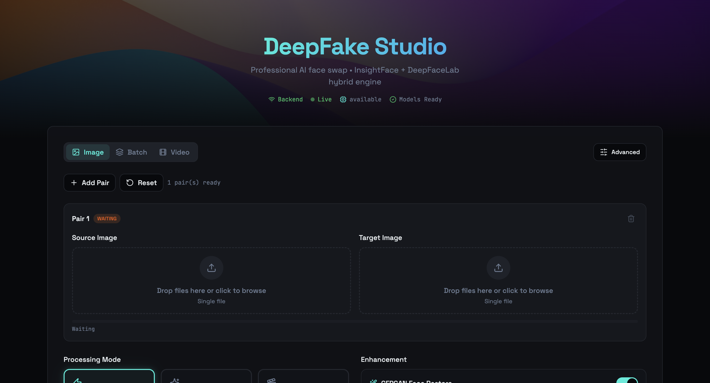

# Face Swap Studio (Hybrid Pipeline)

Professional AI face swap application using InsightFace and DeepFaceLab hybrid engine. This project features a React frontend with a Flask backend.



## 🚀 Getting Started

### Prerequisites
- **Node.js**: 18+ (Recommended 20 LTS)
- **Python**: 3.10+
- **Pip** & **venv**

---

## 🛠️ Installation & Setup

### 1. Clone the repository
```bash
git clone https://github.com/pranto2051/Face-swap-Python-machine-with-ui.git
cd Face-swap-Python-machine-with-ui
```

### 2. Frontend Setup
```bash
# Install dependencies
npm install

# Start development server
npm run dev
```
The frontend will be available at `http://localhost:8080`.

### 3. Backend Setup
It is recommended to use a virtual environment.

**macOS/Linux:**
```bash
# Create virtual environment
python3 -m venv .venv

# Activate virtual environment
source .venv/bin/activate

# Install dependencies
pip install -r backend/requirements.txt

# Run the Flask server
cd backend
python app.py
```

**Windows:**
```powershell
# Create virtual environment
python -m venv .venv

# Activate virtual environment
.\.venv\Scripts\Activate.ps1

# Install dependencies
pip install -r backend/requirements.txt

# Run the Flask server
cd backend
python app.py
```
The backend will be available at `http://127.0.0.1:5001`.

---

## 🏗️ Project Structure

- `src/`: React frontend (Vite + TypeScript + Tailwind CSS)
- `backend/`: Flask server with AI pipelines
- `public/`: Static assets (favicon, images)
- `static/`: Backend processed results

---

## 🧪 Verification
Check if the backend is running properly:
```bash
curl http://127.0.0.1:5001/api/health
```

---

## 📘 Documentation
For more detailed OS-specific setup and common issues, please refer to:
- [Run Frontend and Backend.md](./Run%20FontEnd%20and%20Backend.md)
- [Mac Run.md](./Mac%20Run.md)
- [HYBRID_QUICK_START.md](./backend/HYBRID_QUICK_START.md)

## 🧰 Technologies Used
- **Frontend**: Vite, React, TypeScript, Tailwind CSS, shadcn/ui
- **Backend**: Flask, Socket.io, PyTorch, OpenCV, InsightFace, DeepFaceLab
